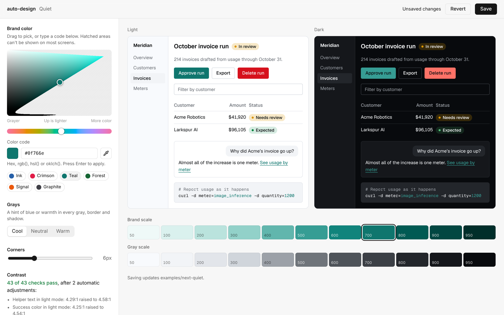
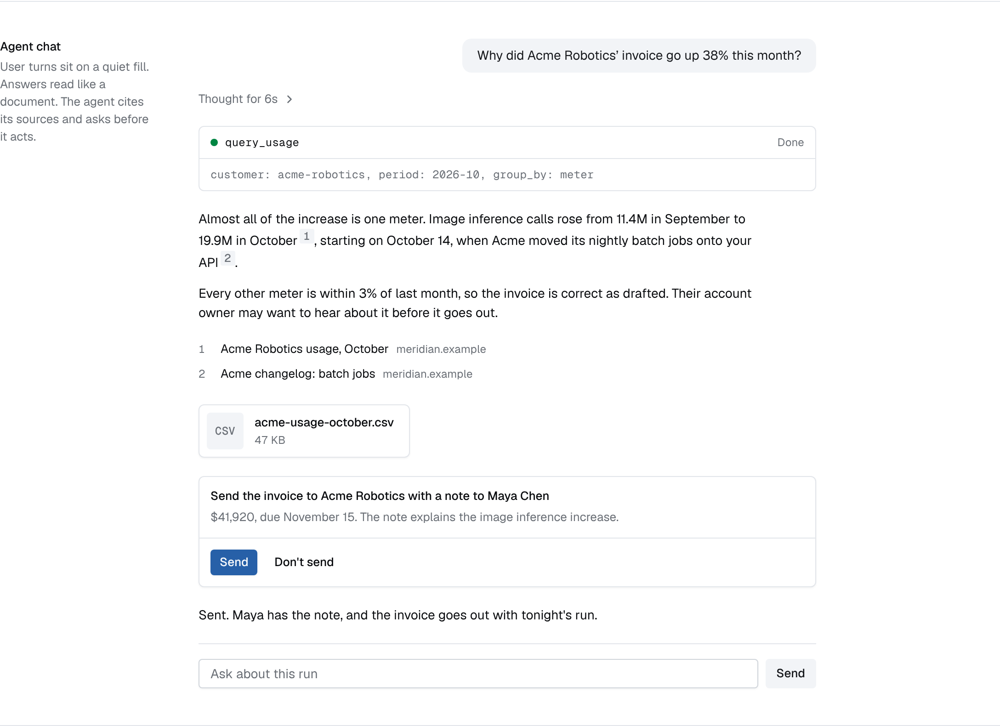
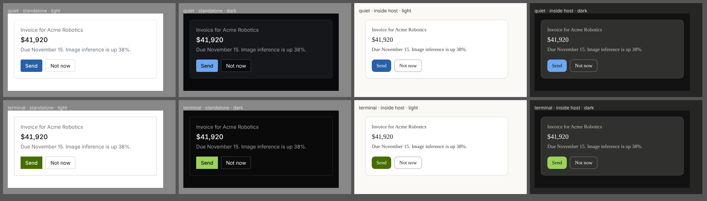
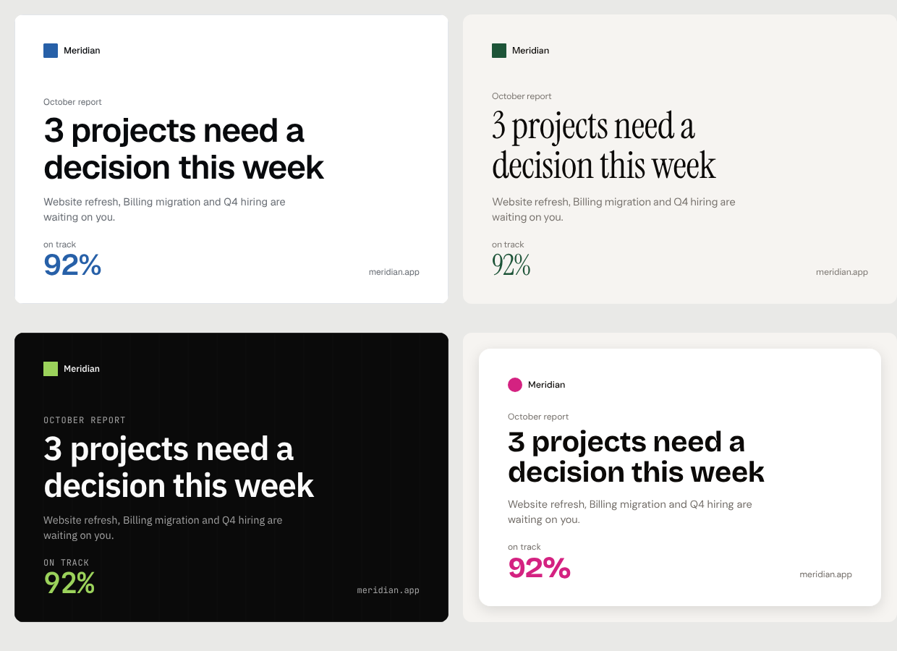

# auto-design

Design systems with hard guardrails, for teams without a designer and for the agents that write their UI.

auto-design turns a handful of taste choices (brand color, type, texture, density, motion) into a design
system repo: W3C design tokens, a locked Tailwind theme, shadcn components, a `DESIGN.md` that coding
agents read, and a checker that fails the build when anything drifts off-system.


> Status: **Phases 0 to 3 done.** Onboarding, five presets, the compiler, the checker, the studio,
> publishing, the docs site, and the agent surfaces (an MCP server, chat components, an MCP Apps adapter,
> iMessage and SMS rules, image cards and `auto-design review`) work end to end. See the [build plan](#roadmap).

## Why guardrails, not guidelines

Agents now write most new UI, and left alone they converge on the same look. A style guide is a suggestion;
an agent under pressure ignores it. auto-design makes the system the only thing that compiles:

1. **Impossible.** The generated Tailwind theme removes Tailwind's defaults. `bg-blue-500`, `text-white`,
   `font-bold` (if bold isn't one of your weights) and `shadow-2xl` stop existing.
2. **Fails the build.** `auto-design check` lints TSX, JSX and CSS deterministically, with no model or
   API key: raw colors, palette classes, arbitrary values, off-scale spacing, type, radius, shadows,
   durations and easings, `scale(0)` entrances, and app CSS that redefines system tokens. Texture rules
   come with the preset: glass only on chrome, never on tables or body text; display fonts only at
   headline sizes.
3. **Visible exceptions.** `// auto-design-allow <rule>: <reason>` suppresses a rule on the next line,
   and every exception is listed in the output.

Contrast is enforced when the system is built: every text and fill pair must reach WCAG AA in light and
dark mode. The compiler fixes what it can and says what it changed.

## Make a design system

You need Node 20 or newer. From a clone of this repo:

```sh
npm install
npx auto-design init      # opens the onboarding app at http://localhost:4400
```


Onboarding asks twelve short questions and draws every answer on your product's own headline, table and
messages, so you choose by looking rather than by reading token names:

1. **Product.** Its name and one line about it. The previews use them instead of lorem ipsum.
2. **Model (optional).** A Claude, OpenAI or OpenRouter key. Claude is recommended. The key stays on your
   machine and the browser never sees it. Without one, every step still works; you lose suggestions and
   "describe a change".
3. **Start.** One of five presets, or your current site and a few screenshots for the model to read.
4. **Feel, texture, type, color, shape, motion.** Each shows its options side by side. Color has a visual
   picker and accepts hex, `rgb()`, `hsl()` or `oklch()`; contrast is checked in light and dark mode as you go.
5. **Surfaces.** Web app, marketing site, code blocks, in-app chat, ChatGPT and Claude apps, iMessage and SMS.
6. **Review and publish.** Writes the repo, commits it, creates the GitHub repo and sets up hosting.

With a model connected you can also type a change ("warmer, less corporate, rounder buttons") at any step.
The model never writes CSS: it proposes a change to the config, the compiler checks it, and you see what
changed before keeping it. Every change can be undone.

Keys are read from `ANTHROPIC_API_KEY`, `OPENAI_API_KEY` or `OPENROUTER_API_KEY` when set.

### Presets

| Preset | Feel |
| --- | --- |
| Quiet | Calm, dense and precise. Geist, hairline borders, 6px corners. For dashboards and tools people use all day. |
| Editorial | Typography carries the design: Instrument Serif headlines, no borders or shadows, color used sparingly. |
| Glass | Frosted navigation and dialogs over solid content, Figtree, rounder corners, springier motion. |
| Terminal | Dark first, dense and exact. IBM Plex Sans with JetBrains Mono labels, 2px corners. |
| Tactile | Soft raised surfaces and buttons that press down. Bricolage Grotesque headlines, 16px corners. |

Skip the browser with `npx auto-design init my-design --preset glass`.

### Publishing

The last step writes the system to a new folder, commits it, and optionally:

- **Creates the GitHub repo**, public or private, with the GitHub CLI if you're signed in (`gh auth login`)
  or with a token you paste. Every push rebuilds the system in CI and fails if the committed files drift.
- **Hosts the docs site and registry** in `public/`:

| Host | What you get |
| --- | --- |
| GitHub Pages | A Pages workflow, turned on for you |
| Vercel | `vercel.json`; deploys if the Vercel CLI is signed in, otherwise an import link |
| Railway or Render | `server.mjs`, a dependency-free server that requires `REGISTRY_TOKEN` on every request |
| Your intranet | `public/` is plain static files; put it behind your existing sign-on |

Private registries work with both installers: `AUTO_DESIGN_TOKEN=... npx auto-design add https://host/r/`.


Each system ships a docs site at `public/index.html`: install commands, the product on every surface you
chose, color scales, the type scale and the component list, in light and dark mode. It is built from the
same tokens, so it doubles as the reference for what on-system looks like.

## Refine it

After publishing, the studio keeps a system and the apps that use it in step. `design.config.ts` stays the
only hand-edited file. To try it on the bundled example:

```sh
npm run dev        # opens the studio for examples/quiet-design and keeps examples/next-quiet in sync
```

To see the synced app, run it in a second terminal:

```sh
cd examples/next-quiet && npm install && npm run dev   # http://localhost:3000
```



In the studio:

- **Pick a brand color.** Drag in the picker, which only offers colors screens can show, or type any code: hex, `rgb()`, `hsl()` or `oklch()`. Chromium browsers also get an eyedropper.
- **Choose gray temperature and corner radius.**
- **Check contrast as you go.** The preview shows light and dark mode, the generated color scales, and every contrast adjustment the compiler made.
- **Save.** Saving rewrites only the edited values in `design.config.ts`, rebuilds the system and copies the CSS into connected apps, which reload on their own. If you edit `design.config.ts` by hand instead, the studio picks that up too.

From the command line:

```sh
npx auto-design init my-design                     # design a system in the browser
npx auto-design init my-design --preset quiet      # or start from a preset, no browser
npx auto-design dev --cwd my-design --app ../my-app # studio + live sync into an app
npx auto-design build --cwd my-design              # rebuild after editing design.config.ts
npx auto-design check --cwd ../my-app              # lint an app against the system
```

```text
✓ Quiet: wrote 53 files to my-design
✓ 43/43 contrast checks pass (WCAG AA)
~ light: muted-foreground on muted was 4.29:1, adjusted to 4.58:1
i dark: primary uses brand-400, a lighter step of the brand color, so it reads as text on dark surfaces.
```

## For agents, and the surfaces they work on

### An MCP server

`npx auto-design add` registers the system's MCP server in the app's `.mcp.json` (and `.cursor/mcp.json`
when the project uses Cursor), next to the DESIGN.md pointer in `AGENTS.md` and `CLAUDE.md`. Agents get the
system as tools, in a system repo or in any app that installed it:

| Tool | What it does |
| --- | --- |
| `get_rules` | DESIGN.md, or one section of it ("color", "chat", "imessage") |
| `get_tokens` | Role colors in light and dark, and the type, spacing, radius, shadow and motion scales |
| `list_components`, `get_component` | What's installable, what's installed, and the source |
| `check_code` | The guardrail checker, on code in memory or files on disk |
| `check_message` | Texting and voice rules for iMessage, SMS, RCS and chat, with a fixed version |
| `render_card` | An image card in the system's style |

Run it yourself with `npx auto-design mcp` (stdio).

### Chat

Systems that target in-app chat add `approval` (the agent asks before it acts), `citation` (inline source
numbers and a source list), `streaming-text` (with a caret, and screen readers hear the finished text once),
`file-card` and `reasoning`, next to `message` and `tool-call`. DESIGN.md gets the rules for using them.



### Inside ChatGPT and Claude

For MCP Apps, `auto-design.css` carries a host layer and the `mcp-host` item adds `applyHostContext()`.
Call it with the host context from `@modelcontextprotocol/ext-apps`. Inside a host, backgrounds, text,
borders, corners and type follow the host's style variables, so the app reads as part of the conversation.
The brand keeps primary actions, focus rings and charts. Outside a host nothing changes.



### iMessage and SMS

A text thread belongs to the phone, so the system holds the words to rules and carries the brand in images:

```sh
npx auto-design message --first "Hey!! Your **report** is READY https://bit.ly/x"
npx auto-design card --title "3 projects need a decision this week" --metric "92%" --out card.png
```

`message` checks for markdown, typographic punctuation that halves an SMS segment, length, a missing sender
name on the first text, a missing opt-out line on marketing SMS, emoji, shouting, more than one link, public
link shorteners and unfilled template variables, then prints a fixed version. `card` draws 1200×800 cards,
1200×630 link previews or 1080×1080 squares in the system's colors, type and texture (PNG through Playwright,
or SVG).



### Review

```sh
npx auto-design review http://localhost:3000/ /pricing
```

`review` opens each page in Chromium at 1280px and 390px, in light and dark mode, and checks what the browser
drew: off-palette colors, text contrast, fonts and sizes off the scale, tap targets under 24px on phones,
sideways scrolling, images without alt text and page errors. With a model key it adds a design critique of the
screenshots against the system's own rules. It writes `review.md` and `review.json` with the screenshots.
`--comment` posts the report on the pull request in GitHub Actions and updates it on later runs, and
`npx auto-design review --init-ci` writes that workflow. Measured errors fail the run; the critique never does.
Reviews need Playwright (`npm i -D playwright`).

## What a design system repo contains

| Path | What it is |
| --- | --- |
| `design.config.ts` | The only hand-edited file: the taste choices, as a typed config |
| `css/auto-design.css` | The locked Tailwind v4 theme and the light and dark role variables |
| `tokens/*.tokens.json` | W3C design tokens (format 2025.10): primitives, plus a file per mode |
| `DESIGN.md` | Instructions for coding agents: roles, scales, motion, voice, how to check |
| `rules/guardrails.json` | What `auto-design check` enforces |
| `public/index.html` | The docs site, drawn in the system |
| `public/r/*.json` | A shadcn registry with a `registry.json` index, ready to host anywhere static |
| `public/DESIGN.md`, `public/llms.txt` | The agent instructions, served next to the registry |
| `specimen.copy.json` | The sample words the docs site and previews use: your headline, your table rows |
| `registry/ui/*.tsx` | 16 component sources (listed below) |
| `code/*.json` | Syntax-highlighting themes for code blocks, generated from the brand |
| `build-report.json` | Every contrast check and every value the compiler adjusted |

## Use it in an app

Any app with Tailwind v4 (Next.js, Vite, React Router, TanStack Start, Astro) can install a system from
its folder or from wherever its `public/r/` is hosted:

```sh
npx auto-design add ../my-design --components all
npx auto-design add https://design.acme.com/r/ --components button,card,dialog
```

`add` finds the CSS file that imports Tailwind and writes `auto-design.css` next to it, importing it
straight after Tailwind. It also writes `DESIGN.md` and the guardrails, points `AGENTS.md` and
`CLAUDE.md` at `DESIGN.md`, adds the font imports to your root file, copies components, and installs
their dependencies with your package manager.

The shadcn CLI works too:

```sh
npx shadcn@latest add https://your-host/r/base.json
npx shadcn@latest add https://your-host/r/button.json
```

The theme reset only works in its own file, imported before any other theme definitions. So both
installers ship a file rather than merging variables into your CSS.

### Components

`button`, `card`, `input`, `textarea`, `label`, `badge`, `separator`, `skeleton`, `table`, `tabs`,
`dialog`, `switch`, `avatar`, `toaster` (Sonner), `message` and `tool-call` for agent chat, and `code-block`
(Shiki, server-rendered). Chat systems add `approval`, `citation`, `streaming-text`, `file-card` and
`reasoning`; MCP Apps systems add `mcp-host`. They are restyled shadcn components built on `radix-ui`,
adjusted to the system's density, motion and texture. Tests run every one through the checker and through
Tailwind for every preset on every surface, so no component uses a class the theme doesn't have.

### Guardrails in the editor

```js
// eslint.config.js
import autoDesign from "@auto-design/eslint-plugin";
export default [autoDesign.configs.recommended];
```

```json
// .stylelintrc.json
{ "plugins": ["@auto-design/stylelint-plugin"], "rules": { "auto-design/guardrails": true } }
```

Both run the same checker as `npx auto-design check` and honor the same `auto-design-allow` comments.

## The Phase 0 test

[`examples/next-quiet`](examples/next-quiet) is a stock `create-next-app` project with the Quiet system
installed through the shadcn CLI from [`examples/quiet-design`](examples/quiet-design).

- Before cleanup, `auto-design check` found 30 errors in the default Next.js template: palette colors,
  hex values, Arial, and template variables overriding the system.
- The specimen page uses only system components and classes: 0 errors, 0 warnings, and `next build` passes.
- `auto-design review` on the running app: no measured problems at 1280px and 390px, in light and dark mode.


## Packages

| Package | What it does |
| --- | --- |
| [`@auto-design/core`](packages/core) | Config schema, OKLCH color engine, type and motion scales, contrast enforcement, emitters |
| [`@auto-design/check`](packages/check) | The guardrail checker (Babel for TSX, PostCSS for CSS) |
| [`@auto-design/presets`](packages/presets) | Quiet, Editorial, Glass, Terminal and Tactile |
| [`@auto-design/ai`](packages/ai) | Model calls (Claude, OpenAI, OpenRouter): onboarding suggestions and refinements as validated config changes, and review critiques |
| [`auto-design`](packages/cli) | The CLI: `init` (onboarding), `dev` (the studio), `add`, `build`, `check`, `mcp`, `message`, `card`, `review`, `presets` |
| [`@auto-design/eslint-plugin`](packages/eslint-plugin) | The checker as ESLint rules |
| [`@auto-design/stylelint-plugin`](packages/stylelint-plugin) | The checker as a Stylelint plugin |

```sh
npm test          # includes 2,790 brand colors across every texture and a check of every generated component
npm run typecheck
```

## Roadmap

| Phase | Ships |
| --- | --- |
| 0 (done) | Config schema, token set, compiler, checker, Quiet preset, Next.js gate |
| 1 (done) | Studio with color picker, `auto-design add` for any Tailwind app, ESLint and Stylelint plugins, code theme, 16 components |
| 2 (done) | Local onboarding app (`npx auto-design init` opens it): model key, taste questions, live previews, GitHub publish and hosting, docs site; Editorial, Glass, Terminal and Tactile presets |
| 3 (done) | Agent surfaces: MCP server, chat components, MCP Apps adapter, iMessage and SMS rules, image cards, `auto-design review` |
| 4 | Public launch, preset gallery, private registry template |

## Credits

Built on [shadcn/ui](https://ui.shadcn.com) and its registry, [Tailwind CSS](https://tailwindcss.com),
[Sonner](https://sonner.emilkowal.ski) by Emil Kowalski for toasts, and typefaces under the SIL Open Font
License: [Geist](https://vercel.com/font), Instrument Sans and Serif, IBM Plex Sans, JetBrains Mono, Figtree,
DM Sans, Bricolage Grotesque, Red Hat Mono, Manrope and Fira Code, served by [Fontsource](https://fontsource.org). Token files follow the [W3C Design Tokens format](https://www.designtokens.org/tr/2025.10/).

## License

MIT
