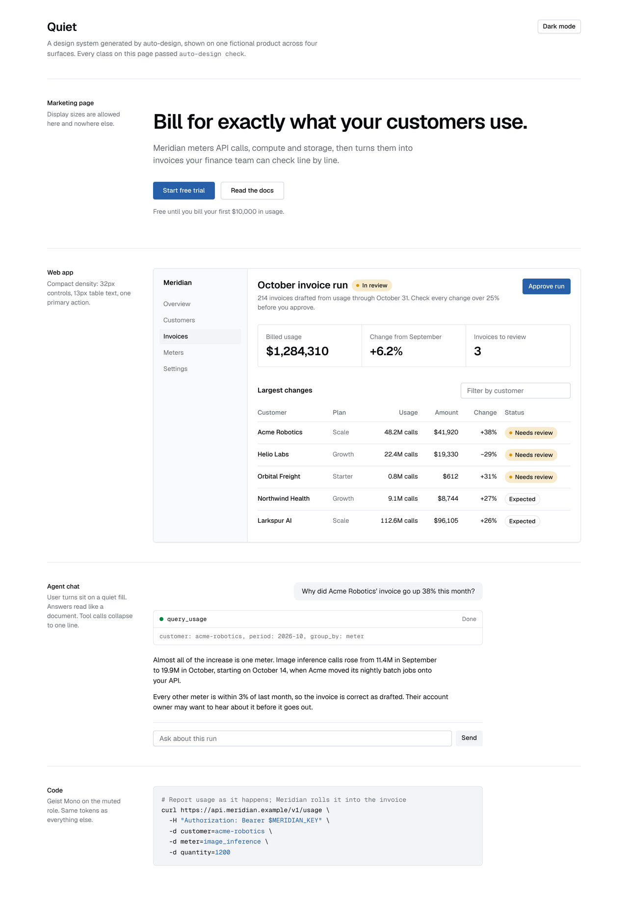
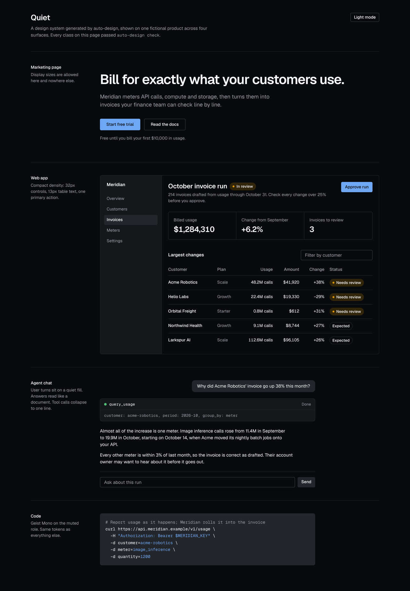

# auto-design

Design systems with hard guardrails, for teams without a designer and for the agents that write their UI.

auto-design turns a handful of taste choices (brand color, type, texture, density, motion) into a design
system repo: W3C design tokens, a locked Tailwind theme, shadcn components, a `DESIGN.md` that coding
agents read, and a checker that fails the build when anything drifts off-system.



> Status: **Phase 0.** The compiler, the checker, the CLI and the Quiet preset work end to end.
> The onboarding app, the other four presets, and the agent surfaces (MCP Apps, iMessage) come next.
> See the [build plan](#roadmap).

## Why guardrails, not guidelines

Agents now write most new UI, and left alone they converge on the same look. A style guide is a suggestion;
an agent under pressure ignores it. auto-design makes the system the only thing that compiles:

1. **Impossible.** The generated Tailwind theme removes Tailwind's defaults. `bg-blue-500`, `text-white`,
   `font-bold` (if bold isn't one of your weights) and `shadow-2xl` stop existing.
2. **Fails the build.** `auto-design check` lints TSX, JSX and CSS deterministically, with no model or
   API key: raw colors, palette classes, arbitrary values, off-scale spacing, type, radius, shadows,
   durations and easings, `scale(0)` entrances, and app CSS that redefines system tokens.
3. **Visible exceptions.** `// auto-design-allow <rule>: <reason>` suppresses a rule on the next line,
   and every exception is listed in the output.

Contrast is enforced when the system is built: every text and fill pair must reach WCAG AA in light and
dark mode. The compiler fixes what it can and says what it changed.

## Try it

```sh
pnpm install
pnpm ad init my-design --preset quiet    # create a design system repo
pnpm ad build --cwd my-design            # recompile after editing my-design/design.config.ts
pnpm ad check --cwd path/to/your/app     # lint an app against the system
```

```text
✓ Quiet: wrote 26 files to my-design
✓ 43/43 contrast checks pass (WCAG AA)
~ light: muted-foreground on muted was 4.3:1, adjusted to 4.58:1
i dark: primary uses brand-400, a lighter step of the brand color, so it reads as text on dark surfaces.
```

Once published, this becomes `npx auto-design init`.

## What a design system repo contains

| Path | What it is |
| --- | --- |
| `design.config.ts` | The only hand-edited file: the taste choices, as a typed config |
| `css/auto-design.css` | The locked Tailwind v4 theme and the light and dark role variables |
| `tokens/*.tokens.json` | W3C design tokens (format 2025.10): primitives, plus a file per mode |
| `DESIGN.md` | Instructions for coding agents: roles, scales, motion, voice, how to check |
| `rules/guardrails.json` | What `auto-design check` enforces |
| `public/r/*.json` | A shadcn registry, ready to host anywhere static |
| `registry/ui/*.tsx` | Component sources: button, card, input, badge, toaster, chat message |
| `build-report.json` | Every contrast check and every value the compiler adjusted |

An app installs it with the shadcn CLI:

```sh
npx shadcn@latest add https://your-host/r/base.json      # theme, DESIGN.md, guardrails
npx shadcn@latest add https://your-host/r/button.json    # components, one at a time
npx auto-design check
```

The base item writes `app/auto-design.css`, imports it straight after Tailwind, and drops `DESIGN.md`
and `auto-design.json` at the project root. The theme reset only works in its own file, imported before
any other theme definitions, which is why the base installs a file rather than merging variables into
your CSS.

## The Phase 0 test

[`examples/next-quiet`](examples/next-quiet) is a stock `create-next-app` project with the Quiet system
installed through the shadcn CLI from [`examples/quiet-design`](examples/quiet-design).

- Before cleanup, `auto-design check` found 30 errors in the default Next.js template: palette colors,
  hex values, Arial, and template variables overriding the system.
- The specimen page uses only system components and classes: 0 errors, 0 warnings, and `next build` passes.



## Packages

| Package | What it does |
| --- | --- |
| [`@auto-design/core`](packages/core) | Config schema, OKLCH color engine, type and motion scales, contrast enforcement, emitters |
| [`@auto-design/check`](packages/check) | The guardrail checker (Babel for TSX, PostCSS for CSS) |
| [`@auto-design/presets`](packages/presets) | Starter systems. Quiet ships now |
| [`auto-design`](packages/cli) | The CLI: `init`, `build`, `check`, `presets` |

```sh
pnpm test        # 27 tests, including: every generated component passes the check for every preset
pnpm typecheck
```

## Roadmap

| Phase | Ships |
| --- | --- |
| 0 (done) | Config schema, token set, compiler, checker, Quiet preset, Next.js gate |
| 1 | ESLint and Stylelint plugins, `auto-design add` for non-Next apps, Shiki theme, more components |
| 2 | Local onboarding app (`npx auto-design init` opens it): model key, taste questions, live specimen, GitHub and Vercel publish; Editorial, Glass, Terminal and Tactile presets |
| 3 | Agent surfaces: MCP server (`get_rules`, `check`), MCP Apps adapter, iMessage image cards and voice rules, `auto-design review` |
| 4 | Public launch, preset gallery, private registry template |

## Credits

Built on [shadcn/ui](https://ui.shadcn.com) and its registry, [Tailwind CSS](https://tailwindcss.com),
[Sonner](https://sonner.emilkowal.ski) by Emil Kowalski for toasts, and [Geist](https://vercel.com/font)
under the SIL Open Font License. Token files follow the [W3C Design Tokens format](https://www.designtokens.org/tr/2025.10/).

## License

MIT
