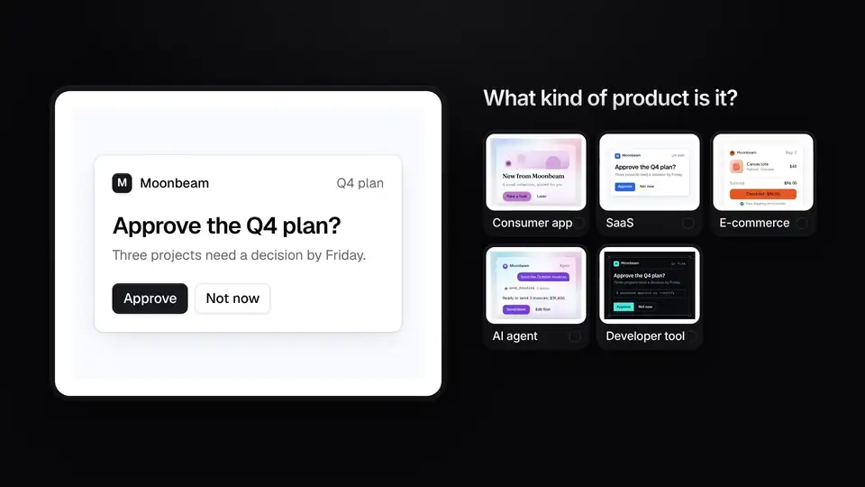
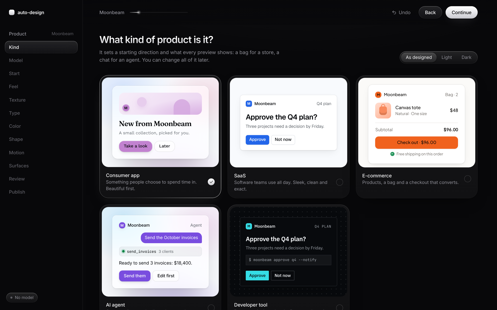
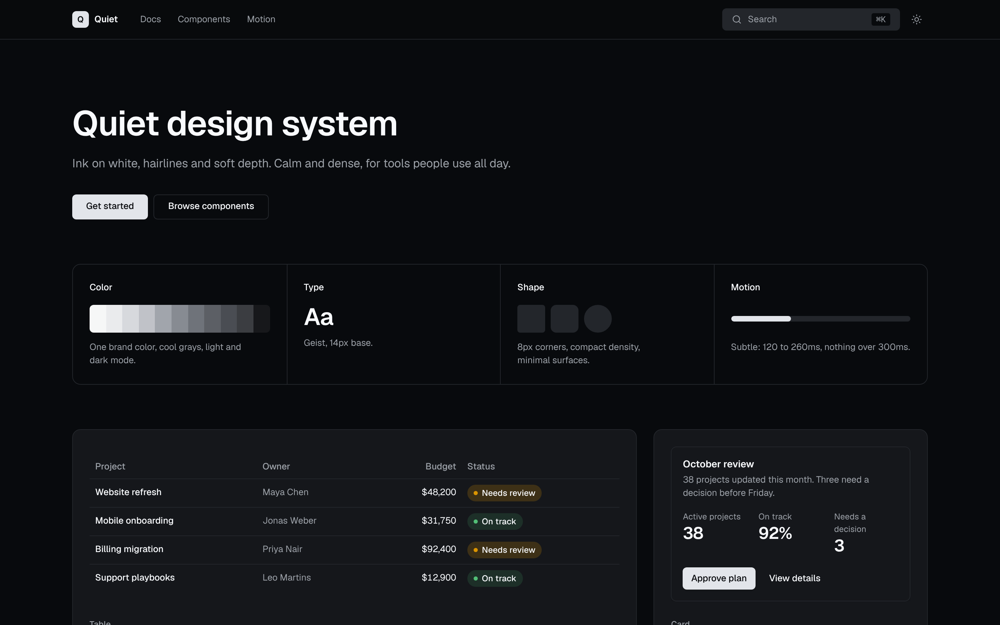

# auto-design

A design system in minutes, and agents that never go off-brand.

auto-design turns a few taste choices into a design system repo: a locked Tailwind v4 theme, shadcn
components, W3C tokens, a `DESIGN.md` for coding agents, a checker that fails the build when anything
drifts, a design site and its own brand animations.

<!-- product-film:start -->
<a href="docs/media/product-film.mp4"></a>

<sub>Recorded from the real onboarding on October 28, 2026 (14401ef). It re-renders when the product's look changes: <code>npm run video</code>. <a href="docs/media/product-film.mp4">Watch the full-size film</a>.</sub>
<!-- product-film:end -->

## Quick start

You need Node 20 or newer.

```sh
git clone https://github.com/fakepixels/auto-design && cd auto-design
npm install
npx auto-design init      # opens onboarding at http://localhost:4400
```

## What's new

<!-- whats-new:start -->
<a href="docs/media/whats-new/2026-10-28-kind-step.mp4"></a>

- **October 28, 2026: A Kind step.** Say what you're making, from a store to an AI agent to a consumer app with a vibe, and every preview follows. [Watch](docs/media/whats-new/2026-10-28-kind-step.mp4)
<!-- whats-new:end -->

## Choose by looking



Onboarding takes about a dozen short steps: what you're making and its vibe, where to start (your own site
and screenshots, or one of five presets), then feel, texture, type, color, corners, motion and where it will
live. Every option is drawn on your own product, so you pick by looking rather than by reading token names.

A Claude, OpenAI or OpenRouter key is optional. With one, onboarding reads your site and takes requests like
"warmer, rounder buttons". The model never writes CSS: it proposes a config change, the compiler checks it,
and you see what changed before you keep it.

## Get the whole system

Publishing writes the repo, commits it, and can create it on GitHub and host it on GitHub Pages, Vercel,
Railway, Render or your intranet.

| Path | What it is |
| --- | --- |
| `design.config.ts` | Your choices, and the only file you edit |
| `css/auto-design.css` | The locked Tailwind v4 theme, light and dark |
| `registry/ui/` | shadcn components restyled to the system, with chat and MCP Apps components when you need them |
| `tokens/` | W3C design tokens |
| `DESIGN.md` | The rules coding agents read |
| `public/` | The design site and a shadcn registry, ready to host anywhere static |

Every text and fill pair passes WCAG AA in light and dark mode. The compiler fixes what it can and says what
it changed.

### A design site of its own



Each system builds a white-label site like ui.shadcn.com: the system at a glance, docs for each foundation,
a page per component with live examples, search, and light and dark mode. Add your own components,
examples and pages in the repo's `components/`, `examples/` and `docs/` folders.

### Brand animations of its own

Logo reveals, announcements, metrics, charts, a product demo, a chat demo and a full launch film, all made
from the system's color, type, corners and motion, in your product's words. The design site plays and edits
them; the CLI renders them to MP4, WebM, GIF or HTML.

```sh
npx auto-design animate announcement --title "Approvals in one click" --format square --out launch.mp4
```

## Agents that stay on-brand

1. **Off-system classes don't exist.** The theme removes Tailwind's defaults, so `bg-blue-500` and
   `shadow-2xl` stop compiling.
2. **Drift fails the build.** `auto-design check` lints TSX, JSX and CSS with no model or key: raw colors,
   arbitrary values, and spacing, type, radius, shadows and motion off the system's scales. It also runs in
   ESLint and Stylelint.
3. **Exceptions are visible.** `// auto-design-allow <rule>: <reason>` allows one line, and every exception is
   listed in the output.

Agents also get the system as tools: `auto-design add` registers an MCP server with the rules, tokens,
components, a code checker, image cards and the animations. Systems can cover in-app chat, apps inside
ChatGPT and Claude, and iMessage and SMS. `auto-design review` checks a running app's pages in a browser and
can comment on pull requests.

## Use it in an app

Any Tailwind v4 app works: Next.js, Vite, React Router, TanStack Start or Astro.

```sh
npx auto-design add ../my-design --components all
npx auto-design add https://design.acme.com/r/ --components button,card,dialog
```

The shadcn CLI installs from the same registry: `npx shadcn@latest add https://design.acme.com/r/button.json`.

| Command | What it does |
| --- | --- |
| `init` | Design a system in the browser, or skip it with `--preset quiet` |
| `dev` | The studio: edit a system and keep connected apps in sync |
| `build` | Rebuild after editing `design.config.ts` |
| `add` | Install a system into an app |
| `check` | Lint an app against the system |
| `serve` | Preview the design site |
| `animate` | Render a brand animation |
| `review` | Check a running app's pages in a browser |
| `mcp`, `message`, `card` | The MCP server, text message rules and image cards |

## Status

Onboarding, five presets, 161 open-source typefaces, the compiler, the checker, the studio, publishing, the
design site, brand animations and the agent surfaces work end to end. Next: blocks and an Agent Skill per
system, brand media (logos, illustrations, social images), more animation scenes with sound, and no-code
editing.

## Develop

```sh
npm test && npm run typecheck
npm run video                         # re-record the film above after a visible change
npx tsx scripts/readme-shots.mts      # re-shoot the screenshots above
```

The packages: [`core`](packages/core) (config, color, scales, emitters, animations),
[`check`](packages/check), [`presets`](packages/presets), [`ai`](packages/ai), [`site`](packages/site),
[`cli`](packages/cli), and the [ESLint](packages/eslint-plugin) and [Stylelint](packages/stylelint-plugin)
plugins. [`examples/quiet-design`](examples/quiet-design) is a generated system, and
[`examples/next-quiet`](examples/next-quiet) is a Next.js app that uses it.

## Credits

Built on [shadcn/ui](https://ui.shadcn.com), [Tailwind CSS](https://tailwindcss.com),
[Sonner](https://sonner.emilkowal.ski) and typefaces under the SIL Open Font License, served by
[Fontsource](https://fontsource.org). Token files follow the
[W3C Design Tokens format](https://www.designtokens.org/tr/2025.10/). The README film is made with
[HyperFrames](https://hyperframes.heygen.com).

## License

MIT
